<div align="center">

# ☸️ Kubernetes for Beginners

### Learn Kubernetes from zero to real-world concepts — one practical day at a time

<a href="#-41-day-learning-roadmap">
  
</a>

[](https://kubernetes.io/)
[](#-41-day-learning-roadmap)
[](#-what-you-will-learn)

**44 hands-on lessons · Real YAML manifests · Ready-to-run demos**

[Start Learning](#-quick-start) · [View Roadmap](#-41-day-learning-roadmap) · [Connect](#-connect)

</div>

---

## 🌱 About This Repository

Kubernetes can feel overwhelming at first. This repository turns it into a clear, practical journey: learn one concept each day, read a short explanation, inspect a real manifest, and run the accompanying commands yourself.

Each lesson is intentionally small so you can focus on **understanding why something exists**, not just memorizing commands.

### Every day includes

- 📖 A beginner-friendly concept explanation
- 🧩 Practical Kubernetes YAML manifests
- 💻 A guided `demo.sh` with commands to try
- ✅ A focused takeaway you can remember

> **New to Kubernetes?** Begin with Day 01 and follow the lessons in order. Already know the basics? Jump directly to the topic you need.

---

## 🎯 What You Will Learn

By completing this learning path, you will understand how to:

- Create and manage Pods, Deployments, ReplicaSets, Jobs, and CronJobs
- Configure applications with ConfigMaps and Secrets
- Perform rolling updates, rollbacks, blue-green, and canary deployments
- Manage storage with Volumes, PersistentVolumes, PVCs, and StorageClasses
- Control scheduling with affinity, node selectors, taints, and tolerations
- Secure workloads using SecurityContexts, ServiceAccounts, RBAC, and NetworkPolicies
- Expose applications with Services, Ingress, and cluster DNS
- Debug workloads using logs, events, `describe`, and `exec`
- Package applications with Helm
- Run stateful and node-level workloads with StatefulSets and DaemonSets
- Scale and optimize workloads with HPA and VPA concepts

---

## 🧰 Prerequisites

Install these tools before starting:

- [Docker](https://docs.docker.com/get-docker/)
- [kubectl](https://kubernetes.io/docs/tasks/tools/)
- [Minikube](https://minikube.sigs.k8s.io/docs/start/) or [Kind](https://kind.sigs.k8s.io/)
- [Helm](https://helm.sh/docs/intro/install/) for Days 37–38
- Git Bash, WSL, Linux, or macOS to run the provided shell scripts

Confirm that your tools and cluster are ready:

```bash
kubectl version --client
minikube start
kubectl get nodes
```

---

## 🚀 Quick Start

### 1. Clone the repository

```bash
git clone https://github.com/yesith-sri/Kubernates-For-Beginners.git
cd Kubernates-For-Beginners
```

### 2. Open the first lesson

```bash
cd day-01
```

### 3. Read, inspect, and practice

```bash
# Read the lesson first, then inspect the commands
cat README.md
cat demo.sh

# Run the guided demo
bash demo.sh
```

> 💡 Read each `demo.sh` before running it. Some lessons create, update, or delete Kubernetes resources as part of the exercise.

---

## 🗺️ 41-Day Learning Roadmap

<details open>
<summary><strong>Phase 1 — Kubernetes Foundations (Days 01–08)</strong></summary>

- [Day 01 — What is a Pod and why does it exist?](./day-01)
- [Day 02 — Writing your first Pod YAML](./day-02)
- [Day 03 — Multi-container Pods](./day-03)
- [Day 04 — Init Containers](./day-04)
- [Day 05 — Sidecar Containers](./day-05)
- [Day 06 — ConfigMaps](./day-06)
- [Day 07 — Secrets](./day-07)
- [Day 08 — ConfigMaps as environment variables vs volume mounts](./day-08)

</details>

<details>
<summary><strong>Phase 2 — Resources, Deployments & Release Strategies (Days 09–17)</strong></summary>

- [Day 09 — Resource requests and limits](./day-09)
- [Day 10 — LimitRange and ResourceQuota](./day-10)
- [Day 11 — Deployments vs ReplicaSets](./day-11)
- [Day 12 — Rolling updates with zero downtime](./day-12)
- [Day 13 — Rolling back a Deployment](./day-13)
- [Day 14 — Blue-green deployments](./day-14)
- [Day 15 — Canary deployments](./day-15)
- [Day 16 — Jobs](./day-16)
- [Day 17 — CronJobs](./day-17)

</details>

<details>
<summary><strong>Phase 3 — Scheduling & Storage (Days 18–22)</strong></summary>

- [Day 18 — Node selectors and node affinity](./day-18)
- [Day 19 — Taints and tolerations](./day-19)
- [Day 20 — Volumes: emptyDir and hostPath](./day-20)
- [Day 21 — PersistentVolumes and PersistentVolumeClaims](./day-21)
- [Day 22 — StorageClasses](./day-22)

</details>

<details>
<summary><strong>Phase 4 — Kubernetes Security (Days 23–27)</strong></summary>

- [Day 23 — SecurityContext](./day-23)
- [Day 24 — ServiceAccounts](./day-24)
- [Day 25 — RBAC: Roles and RoleBindings](./day-25)
- [Day 26 — NetworkPolicies](./day-26)
- [Day 27 — Image security and private registries](./day-27)

</details>

<details>
<summary><strong>Phase 5 — Networking & Observability (Days 28–35)</strong></summary>

- [Day 28 — ClusterIP vs NodePort vs LoadBalancer](./day-28)
- [Day 29 — Ingress routing](./day-29)
- [Day 30 — Ingress controllers](./day-30)
- [Day 31 — DNS in Kubernetes](./day-31)
- [Day 32 — Liveness, readiness, and startup probes](./day-32)
- [Day 33 — Reading logs like a pro](./day-33)
- [Day 34 — The Kubernetes debugging toolkit](./day-34)
- [Day 35 — API deprecations](./day-35)

</details>

<details>
<summary><strong>Phase 6 — Real-World Kubernetes & Cloud (Days 36–44)</strong></summary>

- [Day 36 — Debugging broken Pods](./day-36)
- [Day 37 — Introduction to Helm](./day-37)
- [Day 38 — Installing and upgrading a Helm chart](./day-38)
- [Day 39 — StatefulSets vs Deployments](./day-39)
- [Day 40 — DaemonSets](./day-40)
- [Day 41 — Resource optimization with HPA and VPA concepts](./day-41)
- [Day 42 — Capstone Project: Microservices Voting App](./day-42)
- [Day 43 — Kubernetes in the Cloud: Managed Services & Providers Guide](./day-43)
- [Day 44 — kubeadm: Bootstrap a Production Kubernetes Cluster](./day-44)

</details>

---

## 🧠 A Simple Learning Routine

For the best results, use this four-step routine for every lesson:

1. **Understand** — Read the day's `README.md` and identify the problem the concept solves.
2. **Inspect** — Open the YAML files and connect each field to the explanation.
3. **Practice** — Read and run the commands in `demo.sh` one by one.
4. **Experiment** — Change one safe value, reapply the manifest, and observe what happens.

Do not rush. Consistent daily practice is more valuable than trying to memorize all 41 topics at once.

---

## 🧹 Useful Cleanup Commands

Check what is currently running before removing practice resources:

```bash
kubectl get all
```

Delete a resource created from a manifest:

```bash
kubectl delete -f <manifest-name>.yaml
```

Stop your local Minikube cluster when you finish practicing:

```bash
minikube stop
```

---

## 🤝 Contributing

Found a typo, a clearer explanation, or an idea for another practical lesson? Contributions are welcome.

1. Fork this repository
2. Create a feature branch
3. Make and test your changes
4. Open a pull request with a clear description

---

## ⭐ Support the Project

If this repository helps you understand Kubernetes, consider giving it a **star**. It helps other beginners discover the learning path too.

## 🔗 Connect

Maintained by **Yesith Sri**

[](https://github.com/yesith-sri)

---

<div align="center">

**Learn one concept. Run one demo. Get better every day.** 🚀

</div>
