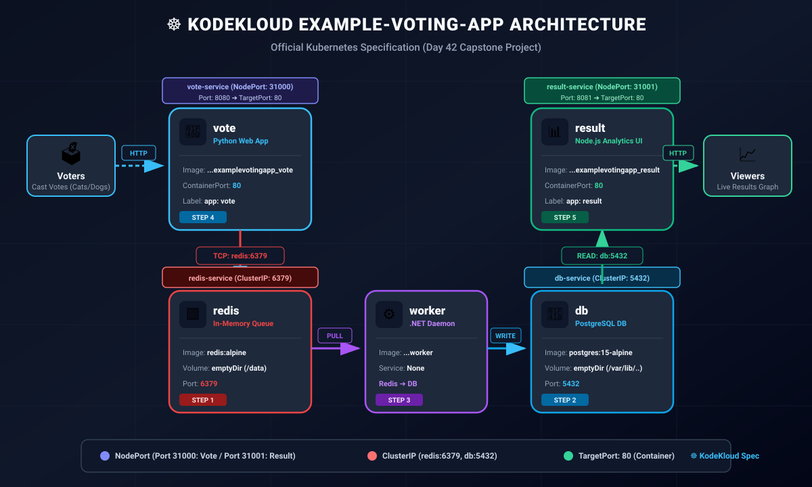
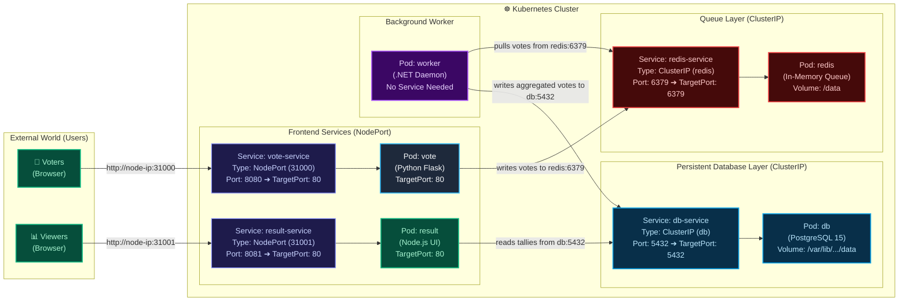

# Day 42 — Capstone Project: KodeKloud Microservices Voting App

## Overview

This project is the official Kubernetes implementation of the industry-standard **Microservices Example Voting App** (from [kodekloudhub/example-voting-app](https://github.com/kodekloudhub/example-voting-app/tree/master/k8s-specifications)).

It synthesizes everything learned from **Day 01 to Day 41** into an end-to-end, multi-tier cloud-native deployment.

---

## Architecture Diagram





---

## 5-Step Implementation Guide

Deploy the system in order of internal dependencies: Data layers first, workers second, and external frontends last.

---

### Step 1: In-Memory Queue (Redis)
Redis holds raw incoming votes in RAM so the database is never overwhelmed by sudden traffic spikes.

* **Deployment (`redis-deployment.yaml`):**
  * Image: `redis:alpine`
  * Container Port: `6379`
  * Volume: `emptyDir: {}` mounted at `/data`
* **Service (`redis-service.yaml`):**
  * Type: `ClusterIP` (Internal only)
  * Service Name: `redis` (must match name so `vote` can discover it via CoreDNS)
  * Port: `6379` ➔ TargetPort: `6379`

```bash
kubectl apply -f redis-deployment.yaml
kubectl apply -f redis-service.yaml
```

---

### Step 2: Relational Database (PostgreSQL)
PostgreSQL permanently stores the aggregated vote count.

* **Deployment (`db-deployment.yaml`):**
  * Image: `postgres:15-alpine`
  * Container Port: `5432`
  * Environment: `POSTGRES_USER=postgres`, `POSTGRES_PASSWORD=postgres`
  * Volume: `emptyDir: {}` mounted at `/var/lib/postgresql/data`
* **Service (`db-service.yaml`):**
  * Type: `ClusterIP` (Internal only)
  * Service Name: `db` (critical: `worker` and `result` connect to host `db`)
  * Port: `5432` ➔ TargetPort: `5432`

```bash
kubectl apply -f db-deployment.yaml
kubectl apply -f db-service.yaml
```

---

### Step 3: Background Worker (.NET)
The worker consumes votes from Redis, processes them, and writes the tallies into PostgreSQL.

* **Deployment (`worker-deployment.yaml`):**
  * Image: `dockersamples/examplevotingapp_worker`
  * Label: `app: worker`
* **Service:**
  * **None needed!** The worker acts purely as a client — it makes outgoing connections to `redis` and `db`. Nothing calls the worker directly.

```bash
kubectl apply -f worker-deployment.yaml
```

---

### Step 4: Voting App (Python Frontend)
The public-facing web UI where users choose between Cats and Dogs.

* **Deployment (`vote-deployment.yaml`):**
  * Image: `dockersamples/examplevotingapp_vote`
  * Container Port: `80` (Python Flask listens on port 80)
* **Service (`vote-service.yaml`):**
  * Type: `NodePort`
  * NodePort: `31000` (User browser port)
  * Port: `8080` (Service port)
  * TargetPort: `80` (Container port)

```bash
kubectl apply -f vote-deployment.yaml
kubectl apply -f vote-service.yaml
```

---

### Step 5: Result App (Node.js Frontend)
The public-facing analytics UI showing real-time vote percentages.

* **Deployment (`result-deployment.yaml`):**
  * Image: `dockersamples/examplevotingapp_result`
  * Container Port: `80`
* **Service (`result-service.yaml`):**
  * Type: `NodePort`
  * NodePort: `31001` (User browser port)
  * Port: `8081` (Service port)
  * TargetPort: `80` (Container port)

```bash
kubectl apply -f result-deployment.yaml
kubectl apply -f result-service.yaml
```

---

## One-Click Deployment Script

To deploy and verify all 5 microservices automatically:

```bash
cd day-42
chmod +x demo.sh
./demo.sh
```

---

## Port Mapping Reference

| Microservice | Internal Container Port (`targetPort`) | Service Port (`port`) | Node Port (`nodePort`) | Access URL |
| :--- | :--- | :--- | :--- | :--- |
| **`vote`** | `80` | `8080` | **`31000`** | `http://<NODE-IP>:31000` |
| **`result`** | `80` | `8081` | **`31001`** | `http://<NODE-IP>:31001` |
| **`redis`** | `6379` | `6379` | *None (ClusterIP)* | `redis:6379` (Internal) |
| **`db`** | `5432` | `5432` | *None (ClusterIP)* | `db:5432` (Internal) |
| **`worker`** | *N/A* | *N/A* | *None* | *Background worker* |

---

## Clean Up

To delete all resources created in this project:

```bash
kubectl delete -f vote-service.yaml,vote-deployment.yaml
kubectl delete -f result-service.yaml,result-deployment.yaml
kubectl delete -f worker-deployment.yaml
kubectl delete -f redis-service.yaml,redis-deployment.yaml
kubectl delete -f db-service.yaml,db-deployment.yaml
```

---

## Files in this Directory

- `voting-app-architecture.svg` — Vector architecture diagram
- `redis-deployment.yaml` — Redis queue Deployment
- `redis-service.yaml` — Redis ClusterIP Service
- `db-deployment.yaml` — PostgreSQL database Deployment
- `db-service.yaml` — PostgreSQL ClusterIP Service (`db`)
- `worker-deployment.yaml` — .NET background processing worker Deployment
- `vote-deployment.yaml` — Python voting web app Deployment
- `vote-service.yaml` — Python voting NodePort Service (`31000`)
- `result-deployment.yaml` — Node.js results dashboard Deployment
- `result-service.yaml` — Node.js results NodePort Service (`31001`)
- `demo.sh` — Automated deployment and verification bash script
