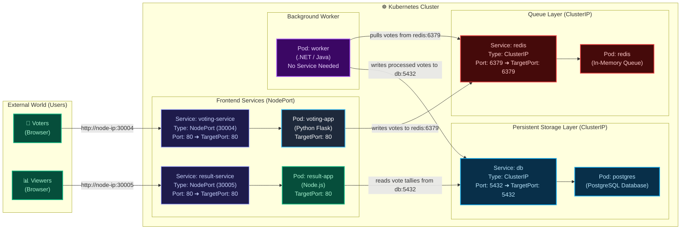

# Day 42 — Capstone Real-World Project: Microservices Voting App

## Overview

Welcome to the **Capstone Real-World Project** of the Kubernetes Master Series! 

In Days 01 through 41, you learned every foundational concept individually — Pods, Deployments, ReplicaSets, ClusterIP, NodePort, Ingress, CoreDNS, Probes, Storage, Self-Healing, and Resource Management. 

Today in **Day 42**, we put all 41 days of knowledge together into a complete, battle-tested, production-grade **Microservices Application: The Example Voting App**.

---

## Architecture Diagram




---

## The 5 Microservices Explained

| Microservice | Technology | Image | Service Type | Role & Data Flow |
| :--- | :--- | :--- | :--- | :--- |
| **`voting-app`** | Python (Flask) | `kodekloud/examplevotingapp_vote:v1` | **NodePort** (`30004`) | Presents the voting web UI (Cats vs Dogs). Sends submitted votes to Redis. |
| **`redis`** | Redis (Alpine) | `redis:alpine` | **ClusterIP** (Port `6379`) | Fast in-memory buffer. Prevents DB bottleneck when thousands vote at once. |
| **`worker`** | .NET / Java | `kodekloud/examplevotingapp_worker:v1` | **None** | Background daemon. Consumes votes from Redis, computes totals, writes to Postgres. |
| **`postgres`** | PostgreSQL | `postgres:15-alpine` | **ClusterIP** (Port `5432`, Name: `db`) | Persistent relational database storing finalized vote tallies. |
| **`result-app`** | Node.js | `kodekloud/examplevotingapp_result:v1` | **NodePort** (`30005`) | Live analytics dashboard. Reads totals from PostgreSQL and displays charts. |

---

## How Days 01–41 Concepts Apply to This Architecture

### 1. Networking: ClusterIP vs. NodePort (Day 28)
- **Why Redis and Postgres use ClusterIP:**
  Databases and message queues must **never** be exposed to the public internet. ClusterIP gives them internal-only IP addresses accessible only within the cluster.
- **Why Voting-app and Result-app use NodePort:**
  Users need to reach these web apps from their browsers outside the cluster. NodePort opens ports `30004` and `30005` on all cluster nodes.

### 2. What `targetPort: 80` Means
- `nodePort: 30004` ➔ The port on the worker node exposed to users (`http://node-ip:30004`).
- `port: 80` ➔ The internal port of the Kubernetes Service.
- `targetPort: 80` ➔ **The actual port inside the container** where the Python Flask or Node.js web server is listening.

### 3. CoreDNS Service Discovery (Day 31)
- The Python voting app connects to Redis using the hostname `redis`.
- The worker app and result app connect to PostgreSQL using the hostname `db`.
- **Zero hardcoded IPs!** CoreDNS automatically translates `redis` ➔ `redis.default.svc.cluster.local` and `db` ➔ `db.default.svc.cluster.local`.

### 4. Self-Healing Mechanism (Day 11)
- If the Redis Pod or PostgreSQL Pod crashes or runs out of memory (OOMKilled), the Deployment immediately detects `Actual Replicas (0) < Desired Replicas (1)` and spawns a fresh replacement Pod in seconds without manual intervention.

### 5. Resource Requests and Limits (Day 09)
- Every Deployment in this project defines explicit CPU and memory `requests` and `limits`, preventing any single microservice from starving the node.

---

## Step-by-Step Deployment Guide

You can deploy the entire application using the provided automated script or manually:

### Option A: Automated Script
```bash
cd day-42
chmod +x demo.sh
./demo.sh
```

### Option B: Manual Step-by-Step

```bash
# 1. Deploy Redis in-memory queue
kubectl apply -f redis.yaml

# 2. Deploy PostgreSQL database
kubectl apply -f postgres.yaml

# 3. Deploy Background Worker
kubectl apply -f worker.yaml

# 4. Deploy Voting Web App
kubectl apply -f voting-app.yaml

# 5. Deploy Result Analytics App
kubectl apply -f result-app.yaml
```

### Verify Deployment Status
```bash
# Check all Pods and Deployments
kubectl get deployments
kubectl get pods -o wide

# Check Services and Port mappings
kubectl get services
```

---

## Accessing the Application

Once all Pods are in the `Running` state:

1. **Cast a Vote:**
   Open your browser to: `http://<NODE-IP>:30004`
2. **View Live Results:**
   Open your browser to: `http://<NODE-IP>:30005`

> **Minikube Users:**
> ```bash
> minikube service voting-service --url
> minikube service result-service --url
> ```

---

## Clean Up

To remove all resources created by this project:

```bash
kubectl delete -f voting-app.yaml
kubectl delete -f result-app.yaml
kubectl delete -f worker.yaml
kubectl delete -f redis.yaml
kubectl delete -f postgres.yaml
```

---

## Key Interview Questions

**Q1: In the Voting App, why does the PostgreSQL service need to be named specifically `db`?**
> **Answer:** Because the `worker` application and `result-app` have the connection string configured with host `db`. Kubernetes CoreDNS uses the Service name as the DNS host, so naming the Service `db` allows automatic resolution without modifying application code or passing custom environment variables.

**Q2: Why does the background `worker` microservice not require a Kubernetes Service?**
> **Answer:** A Service is only required when other components need to initiate network connections *to* the Pod. The worker acts purely as a consumer (client): it initiates outgoing connections to pull from Redis and push to PostgreSQL. Since no component calls the worker directly, no Service is needed.

**Q3: Why is Redis placed in front of PostgreSQL instead of having the voting app write directly to PostgreSQL?**
> **Answer:** Traffic decoupling and queue buffering. Under sudden high spikes of voting traffic, direct database writes would overwhelm PostgreSQL connections and disk I/O, leading to database lockups. Redis handles thousands of in-memory writes per second with sub-millisecond latency, while the worker smoothly drains the queue at a sustainable pace for PostgreSQL.

---

## Files in this Project

- `voting-app-architecture.svg` — Vector architecture diagram
- `voting-app.yaml` — Deployment & NodePort Service for Python voting frontend
- `redis.yaml` — Deployment & ClusterIP Service for Redis queue
- `worker.yaml` — Deployment for .NET background processing worker
- `postgres.yaml` — Deployment & ClusterIP Service for PostgreSQL database
- `result-app.yaml` — Deployment & NodePort Service for Node.js results frontend
- `demo.sh` — Bash script to deploy, verify, and launch the entire application
