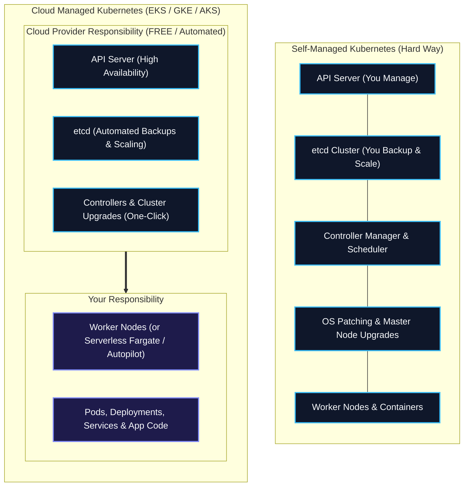

# Day 43 — Kubernetes in the Cloud: Managed Services & Cloud Providers Guide

## Overview

Up to this point, you have learned how Kubernetes operates locally (using Minikube or Kind) and deployed a real-world microservices application on it.

In enterprise production environments, companies rarely install Kubernetes manually on raw virtual machines from scratch. Instead, they leverage **Managed Kubernetes Services** provided by major Cloud Providers.

This guide provides an end-to-end breakdown of running Kubernetes in the Cloud, the shared responsibility model, major cloud providers, official documentation links, and how to choose the right provider for your project.

---

## 🏗️ Self-Managed vs. Managed Kubernetes

Before cloud managed services, teams had to deploy Kubernetes using tools like `kubeadm` on raw VMs (EC2, Compute Engine).



### The Shared Responsibility Model:
* **The Control Plane (Master Nodes):** The Cloud Provider manages the API Server, etcd database, scheduler, and controller manager across multiple Availability Zones with guaranteed SLA uptime (e.g., 99.95%).
* **The Worker Nodes & Workloads:** You choose the size and quantity of worker nodes (or use serverless node modes) and deploy your applications.

---

## ☁️ The "Big Three" Cloud Providers

### 1. Google Cloud Platform (GCP) — Google Kubernetes Engine (GKE)

Google invented Borg (the precursor to Kubernetes) and open-sourced Kubernetes in 2014. GKE is widely recognized as the most advanced, seamless, and mature Kubernetes implementation in the cloud.

* **Flagship Features:**
  * **GKE Autopilot:** A fully automated mode where Google manages node provisioning, autoscaling, security hardening, and OS patching. You only pay for the Pod resources (CPU/RAM) you request!
  * **Native Networking:** Direct integration with Google Cloud VPCs (VPC-native traffic routing).
  * **Fast Upgrades:** Rapid release cycle tracking upstream Kubernetes versions with automatic cluster upgrades.
* **Official Links & Resources:**
  * 📖 [Official GKE Documentation](https://cloud.google.com/kubernetes-engine/docs)
  * 🚀 [GKE Quickstart Tutorial](https://cloud.google.com/kubernetes-engine/docs/deploy-app-cluster)
  * 💡 [GKE Autopilot Overview](https://cloud.google.com/kubernetes-engine/docs/concepts/autopilot-overview)

---

### 2. Amazon Web Services (AWS) — Amazon Elastic Kubernetes Service (EKS)

AWS EKS is the most widely adopted enterprise managed Kubernetes service, tightly integrated with the massive AWS ecosystem (IAM, VPC, ALB, EBS, S3).

* **Flagship Features:**
  * **AWS Fargate for EKS:** Serverless compute engine for Pods — runs each Pod in its own isolated VM without managing EC2 worker nodes.
  * **IRSA (IAM Roles for Service Accounts):** Maps AWS IAM permissions directly to Kubernetes ServiceAccounts (from Day 24 & 25).
  * **AWS Load Balancer Controller:** Automatically provisions AWS Application Load Balancers (ALB) and Network Load Balancers (NLB) from Ingress and Service objects.
* **Official Links & Resources:**
  * 📖 [Official AWS EKS Documentation](https://docs.aws.amazon.com/eks/)
  * 🚀 [AWS EKS Getting Started Guide](https://docs.aws.amazon.com/eks/latest/userguide/getting-started.html)
  * 🛠️ [eksctl — The Official CLI for Amazon EKS](https://eksctl.io/)
  * 🔐 [IAM Roles for Service Accounts (IRSA)](https://docs.aws.amazon.com/eks/latest/userguide/iam-roles-for-service-accounts.html)

---

### 3. Microsoft Azure — Azure Kubernetes Service (AKS)

Azure AKS is the fastest-growing enterprise Kubernetes service, providing deep integration with Microsoft Active Directory, Windows Server containers, and Azure DevOps.

* **Flagship Features:**
  * **Microsoft Entra ID (Azure AD) Integration:** Seamless RBAC mapping corporate users and groups directly to Kubernetes Roles.
  * **Virtual Nodes (ACI):** Burst scaling using Azure Container Instances for instant pod scaling without waiting for VM nodes to boot.
  * **First-Class Windows Containers:** Outstanding support for mixed clusters running Linux and Windows container nodes side by side.
  * **Free Control Plane:** No hourly charge for standard cluster management.
* **Official Links & Resources:**
  * 📖 [Official Azure AKS Documentation](https://learn.microsoft.com/en-us/azure/aks/)
  * 🚀 [Azure AKS Quickstart Guide](https://learn.microsoft.com/en-us/azure/aks/learn/quick-kubernetes-deploy-portal)
  * 🌐 [Azure AKS Networking Concepts (Azure CNI vs Kubenet)](https://learn.microsoft.com/en-us/azure/aks/concepts-network)

---

## 🏢 Alternative & Developer-Friendly Cloud Providers

| Provider | Service Name | Best For | Official Documentation |
| :--- | :--- | :--- | :--- |
| **DigitalOcean** | **DOKS** (DigitalOcean Kubernetes) | Developers, startups, staging environments, low cost with zero control plane fee. | [DigitalOcean DOKS Docs](https://docs.digitalocean.com/products/kubernetes/) |
| **Red Hat / IBM** | **OpenShift (ROSA / ARO / OCP)** | High-security financial & government enterprises, built-in developer portal, strict compliance. | [Red Hat OpenShift Docs](https://docs.openshift.com/) |
| **Oracle Cloud** | **OKE** (Oracle Container Engine) | High-performance computing, ARM architecture, generous Free Tier. | [Oracle OKE Docs](https://docs.oracle.com/en-us/iaas/Content/ContEng/Concepts/contengoverview.htm) |
| **Akamai / Linode** | **LKE** (Linode Kubernetes Engine) | Lightweight workloads, transparent pricing, simple management. | [Linode LKE Docs](https://www.linode.com/docs/products/compute/kubernetes/) |

---

## 📊 Comprehensive Provider Comparison Matrix

| Feature | AWS EKS | Google GKE | Azure AKS | DigitalOcean DOKS |
| :--- | :--- | :--- | :--- | :--- |
| **Control Plane Fee** | \$0.10 / hour (~$73/mo) | Free for 1 cluster / \$0.10/hr | Free (Standard) / SLA option | **FREE** |
| **Serverless Pods** | AWS Fargate | GKE Autopilot | Virtual Nodes (ACI) | No |
| **Identity Integration** | AWS IAM (IRSA) | Google Cloud IAM / Workload Identity | Microsoft Entra ID (Azure AD) | DigitalOcean Tokens |
| **Storage Provisioners** | EBS CSI, EFS CSI | GCE Persistent Disk, Filestore | Azure Disk CSI, Azure Files | DO Block Storage |
| **Ingress Controller** | AWS Load Balancer Controller | GKE Ingress (Cloud Load Balancing) | Application Gateway Ingress (AGIC) | Nginx / DO Load Balancers |
| **Complexity Level** | Moderate to High | Low to Moderate | Moderate | **Very Low** |

---

## 🧭 How to Choose the Right Provider

```mermaid
flowchart TD
    Start["Where should I run Kubernetes in the Cloud?"] --> Q1{"Where is your existing infrastructure & data?"}

    Q1 -->|Mostly AWS (S3, RDS, DynamoDB)| EKS["👉 Choose Amazon EKS\n(Best ecosystem integration)"]
    Q1 -->|Mostly Azure (Active Directory, .NET, Windows)| AKS["👉 Choose Azure AKS\n(Best Microsoft/AD integration)"]
    Q1 -->|Starting fresh or want the purest K8s experience| Q2{"What is your priority?"}

    Q2 -->|Want zero node management & top automation| GKE_Auto["👉 Choose GKE Autopilot\n(Purest K8s & lowest ops burden)"]
    Q2 -->|Budget-conscious / Startups / Personal Projects| DO["👉 Choose DigitalOcean DOKS\n(Simple, free control plane, low cost)"]
    Q2 -->|Strict enterprise compliance & security| OCP["👉 Choose Red Hat OpenShift\n(ROSA on AWS / ARO on Azure)"]

    classDef opt fill:#0f172a,stroke:#38bdf8,stroke-width:2px,color:#f8fafc;
    class EKS,AKS,GKE_Auto,DO,OCP opt;
```

---

## 🎯 Top Cloud Kubernetes Interview Questions

**Q1: What is the difference between Self-Managed Kubernetes and Managed Kubernetes (like EKS, GKE, or AKS)?**
> **Answer:** In Self-Managed Kubernetes, the engineering team is responsible for managing, patching, securing, and backing up the control plane master nodes (API Server, etcd, Scheduler) as well as the worker nodes. In Managed Kubernetes, the cloud provider manages the entire control plane with automated multi-zone high availability and backups, while the user only manages worker nodes and workloads.

**Q2: What is GKE Autopilot, and how does it differ from GKE Standard?**
> **Answer:** In GKE Standard, you manage and pay for the underlying Compute Engine VM worker nodes. In GKE Autopilot, Google manages the entire cluster infrastructure including node provisioning, scaling, bin-packing, and security hardening. You do not manage VMs or nodes; you only pay for the exact CPU, memory, and storage requested by your running Pods.

**Q3: How do Pods in AWS EKS securely access AWS services (like S3 or DynamoDB) without hardcoding secret keys?**
> **Answer:** Using **IRSA (IAM Roles for Service Accounts)**. By associating an AWS IAM Role with a Kubernetes ServiceAccount through an OIDC identity provider, EKS automatically injects temporary AWS credentials into the Pod. The application uses the AWS SDK to seamlessly access AWS resources without requiring static API keys or Secrets.

**Q4: What is the difference between AWS Fargate for EKS and traditional EC2 worker nodes?**
> **Answer:** EC2 worker nodes require you to select VM instances, manage operating system patches, monitor node capacity, and configure autoscaling groups. AWS Fargate is a serverless compute engine: each Pod runs in its own dedicated, isolated micro-VM. AWS handles all OS patching, scaling, and node management, allowing developers to focus solely on container workloads.

---

## 🏁 Summary

| Concept | Key Takeaway |
| :--- | :--- |
| **Control Plane** | Always let the cloud provider manage this (high availability, automated etcd backups). |
| **Google GKE** | The gold standard for pure Kubernetes and automation (Autopilot). |
| **AWS EKS** | The industry leader for deep AWS ecosystem integration (IRSA, Fargate, ALB). |
| **Azure AKS** | The enterprise powerhouse for Active Directory and hybrid Windows/Linux environments. |
| **DOKS** | The best lightweight, cost-effective option for learning, testing, and small startups. |
