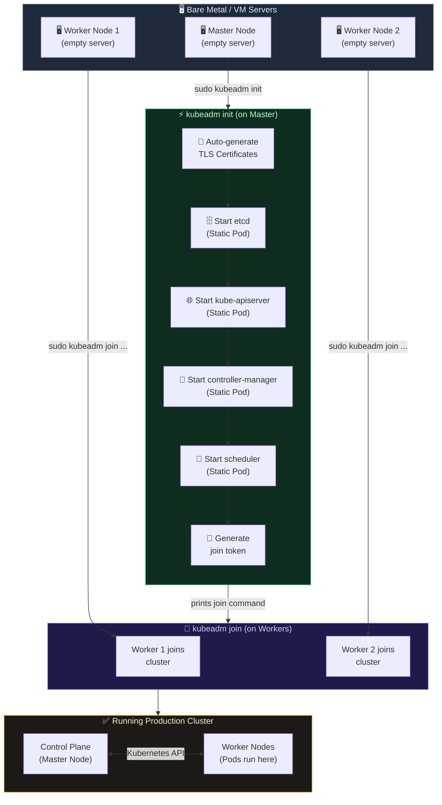
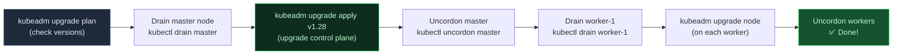

# Day 44 — kubeadm: Bootstrap a Production Kubernetes Cluster

> **"Before kubeadm existed, setting up a Kubernetes cluster from scratch took days of manual work — hundreds of commands, 15+ TLS certificates, and lots of tears. kubeadm changed everything."**

---

## 📌 What is kubeadm?

**kubeadm** is the **official Kubernetes cluster bootstrap tool** — a CLI that automates the painful process of setting up a production-grade multi-node Kubernetes cluster on real servers or VMs.

| | |
|---|---|
| 🔧 **Created by** | Kubernetes SIG Cluster Lifecycle team |
| 📦 **What it does** | Bootstraps the control plane + joins worker nodes |
| 🏭 **Where it runs** | Bare-metal servers, VMs, on-premises datacenters |
| 🎓 **Why it matters** | Core tool for the **CKA exam** + real production clusters |

---

## 🔥 The Problem: "Kubernetes the Hard Way"

Before kubeadm, to set up a Kubernetes cluster you had to:

```
❌ Manually generate 15–20 TLS certificates (CA, apiserver, etcd, kubelet...)
❌ Manually configure etcd cluster from scratch
❌ Write systemd unit files for every control plane component
❌ Configure kube-apiserver, controller-manager, scheduler by hand
❌ Set up kubeconfig files, RBAC policies, networking rules
❌ This took 2–3 DAYS of expert-level work
```

**kubeadm solves all of this in ~10 minutes with 2 commands.**

---

## 🏗️ Architecture: How kubeadm Bootstraps a Cluster



---

## 🛠️ Step-by-Step: Setting Up a Cluster with kubeadm

### Prerequisites (all nodes)

Install these on **every node** (master + workers):

```bash
# Install container runtime (containerd)
sudo apt-get install -y containerd

# Install Kubernetes tools
sudo apt-get install -y kubelet kubeadm kubectl

# Disable swap (Kubernetes requires this)
sudo swapoff -a
```

---

### Step 1: Initialize the Master Node

Run **only on the Master Node**:

```bash
sudo kubeadm init --pod-network-cidr=192.168.0.0/16
```

**What happens internally:**
```
✅ Generates all TLS certificates → /etc/kubernetes/pki/
✅ Writes kubeconfig files       → /etc/kubernetes/*.conf
✅ Starts etcd as a Static Pod
✅ Starts kube-apiserver as a Static Pod
✅ Starts kube-controller-manager as a Static Pod
✅ Starts kube-scheduler as a Static Pod
✅ Generates a join token        → prints it at the end
```

**Output at the end (save this!):**
```bash
kubeadm join 192.168.1.10:6443 \
  --token abcdef.0123456789abcdef \
  --discovery-token-ca-cert-hash sha256:abc123...
```

---

### Step 2: Configure kubectl on Master

```bash
mkdir -p $HOME/.kube
sudo cp -i /etc/kubernetes/admin.conf $HOME/.kube/config
sudo chown $(id -u):$(id -g) $HOME/.kube/config
```

---

### Step 3: Install a CNI (Pod Network)

Kubernetes pods need a network plugin to communicate:

```bash
# Option A: Calico (most popular)
kubectl apply -f https://docs.projectcalico.org/manifests/calico.yaml

# Option B: Flannel
kubectl apply -f https://raw.githubusercontent.com/flannel-io/flannel/master/Documentation/kube-flannel.yml
```

---

### Step 4: Join Worker Nodes

Run **on each Worker Node** (use the token from Step 1):

```bash
sudo kubeadm join 192.168.1.10:6443 \
  --token abcdef.0123456789abcdef \
  --discovery-token-ca-cert-hash sha256:abc123...
```

---

### Step 5: Verify the Cluster

```bash
# Check all nodes are Ready
kubectl get nodes

# Output:
# NAME        STATUS   ROLES           AGE   VERSION
# master      Ready    control-plane   5m    v1.28.0
# worker-1    Ready    <none>          2m    v1.28.0
# worker-2    Ready    <none>          2m    v1.28.0
```

---

## 📊 kubeadm vs Minikube vs Managed Cloud

| Feature | 🐱 Minikube / Kind | ☁️ Managed Cloud (EKS/GKE/AKS) | 🔧 kubeadm |
|---|---|---|---|
| **Where it runs** | Laptop (Docker/VM) | AWS / Google / Azure | Real servers / VMs |
| **Use case** | Learning, local dev | Cloud production | On-prem production |
| **Control plane** | Auto-managed | Managed by provider | You manage it |
| **Cost** | Free | Pay provider | Hardware cost only |
| **Setup time** | 2 minutes | 10 minutes | 30–60 minutes |
| **Full control** | ❌ | ⚠️ Limited | ✅ Full |
| **CKA exam** | ❌ Not tested | ❌ Not tested | ✅ Core topic |
| **Who uses it** | Students | Startups / Enterprises | Banks, Gov, Security orgs |

> **💡 Rule of thumb:**  
> - **Minikube** = Practice at home 🏠  
> - **EKS/GKE/AKS** = Don't want to manage infra ☁️  
> - **kubeadm** = Need full control on your own hardware 🏭

---

## ⬆️ Cluster Upgrades with kubeadm

One of kubeadm's most powerful features — **zero-downtime Kubernetes version upgrades**:

```bash
# Step 1: Check what upgrade is available
kubeadm upgrade plan

# Output shows:
# COMPONENT            CURRENT   TARGET
# kube-apiserver       v1.27.0   v1.28.0
# kube-controller-mgr  v1.27.0   v1.28.0
# kube-scheduler       v1.27.0   v1.28.0
# etcd                 3.5.6     3.5.9

# Step 2: Apply the upgrade
sudo kubeadm upgrade apply v1.28.0
```

**Upgrade flow:**


---

## 🎯 Why kubeadm Matters in the Real World

```
🏦 Banking & Finance    → Strict data sovereignty (can't put data in cloud)
🏛️ Government          → Security regulations require on-premises
🏥 Healthcare          → Patient data must stay in-house
🔒 High Security Orgs  → Full network isolation required
🎓 CKA Certification  → kubeadm is THE core tool tested
```

---

## 📁 Important Paths After kubeadm init

| Path | What's there |
|---|---|
| `/etc/kubernetes/pki/` | All TLS certificates |
| `/etc/kubernetes/admin.conf` | Admin kubeconfig |
| `/etc/kubernetes/manifests/` | Static Pod YAMLs (apiserver, etcd, etc.) |
| `/var/lib/kubelet/` | Kubelet configuration |
| `/var/lib/etcd/` | etcd data |

---

## 🗑️ Reset / Clean Up

```bash
# Reset a node (removes all Kubernetes configuration)
sudo kubeadm reset

# Clean up iptables rules
sudo iptables -F && sudo iptables -t nat -F
```

---

## 🔗 Official Documentation

| Resource | Link |
|---|---|
| 📖 kubeadm Reference | https://kubernetes.io/docs/reference/setup-tools/kubeadm/ |
| 🚀 Create a cluster with kubeadm | https://kubernetes.io/docs/setup/production-environment/tools/kubeadm/create-cluster-kubeadm/ |
| ⬆️ Upgrading clusters | https://kubernetes.io/docs/tasks/administer-cluster/kubeadm/kubeadm-upgrade/ |
| 🌐 Installing a CNI | https://kubernetes.io/docs/concepts/cluster-administration/addons/ |

---

## 🎓 Interview Questions & Answers

**Q1: What is kubeadm and what problem does it solve?**  
> kubeadm is the official Kubernetes bootstrap tool. It solves the problem of manually setting up a cluster ("Kubernetes the Hard Way") which required generating 15+ TLS certs, configuring etcd, and writing systemd files — taking days. kubeadm does this in ~10 minutes.

**Q2: What does `kubeadm init` do internally?**  
> It generates all TLS certificates, writes kubeconfig files, starts control plane components (etcd, apiserver, controller-manager, scheduler) as Static Pods, and generates a join token for worker nodes.

**Q3: What is a Static Pod in the context of kubeadm?**  
> Static Pods are Pods managed directly by kubelet on a specific node, without going through the API server. kubeadm places control plane components (etcd, apiserver, etc.) as Static Pods in `/etc/kubernetes/manifests/`.

**Q4: What is the difference between kubeadm, kubectl, and kubelet?**  
> - **kubeadm** — Bootstrap/setup tool (used once at cluster creation)  
> - **kubectl** — CLI to interact with the cluster (used daily)  
> - **kubelet** — Node agent that runs on every node (always running)

**Q5: What command do you run to add a worker node to an existing cluster?**  
> `sudo kubeadm join <master-ip>:6443 --token <token> --discovery-token-ca-cert-hash sha256:<hash>`

**Q6: If the join token expires, how do you generate a new one?**  
> `kubeadm token create --print-join-command`

**Q7: What is the purpose of a CNI plugin after `kubeadm init`?**  
> Without a CNI (Container Network Interface), pods cannot communicate across nodes. kubeadm doesn't install a CNI by default — you must apply one (e.g., Calico, Flannel) separately.

**Q8: How do you upgrade a Kubernetes cluster managed by kubeadm?**  
> 1. `kubeadm upgrade plan` — check available versions  
> 2. `kubeadm upgrade apply v<version>` — upgrade control plane  
> 3. `kubectl drain <node>` → `kubeadm upgrade node` → `kubectl uncordon <node>` — upgrade each worker

---

## 📝 Summary

| Concept | Key Point |
|---|---|
| **kubeadm init** | Sets up the entire control plane automatically |
| **kubeadm join** | Adds worker nodes to the cluster |
| **kubeadm upgrade** | Zero-downtime cluster version upgrades |
| **Static Pods** | How control plane runs (managed by kubelet, not API server) |
| **CNI required** | Must install separately (Calico / Flannel) |
| **Best for** | On-premises / bare-metal / full-control environments |
| **CKA relevance** | Core exam topic — you will use kubeadm on the exam |

---

*Day 44 of #LearnKubernetes — From Laptop to Production Cluster 🚀*
